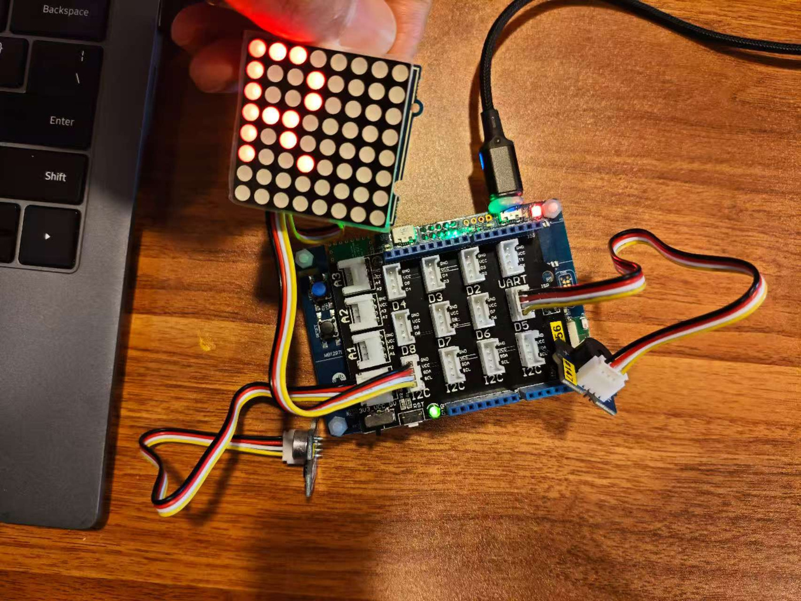

# STM32 Multi-Sensor Game System

Bare-metal firmware for the STMicroelectronics **B-L4S5I-IOT01A** Discovery kit (STM32L4S5VI, Arm Cortex-M4F). It turns the board's on-board MEMS and environmental sensors, plus an external sound sensor, 8×8 LED matrix and buzzer, into two interactive games. Both games live in **one firmware image on one board**; a double press of the user button switches between them at runtime. It is written in Embedded C on the STM32 HAL and the board BSP, and runs as a single non-blocking super-loop with interrupt-driven button input.

Built as a team assignment for EE2028 at the National University of Singapore (AY2025/26 Semester 1).

**At a glance**

| | |
|---|---|
| Platform | STM32L4S5 (Cortex-M4F) on B-L4S5I-IOT01A, STM32CubeIDE, STM32 HAL + BSP |
| Inputs | 6-axis IMU, magnetometer, temperature, humidity, pressure (on-board, via I2C2); analog sound sensor (ADC1); user button (EXTI) |
| Outputs | HT16K33 8×8 LED matrix (I2C1), active buzzer (GPIO), on-board LED (GPIO), UART log (USART1) |
| Firmware design | Bare-metal super-loop, `HAL_GetTick()`-based non-blocking timing, per-game state machines, interrupt-driven button with debounce and single/double-press detection |

---

## Hardware Setup



*The B-L4S5I-IOT01A board under an Arduino-compatible base shield, with the HT16K33 8×8 LED matrix (I2C), the analog sound sensor and the buzzer connected by cables. Photo taken from the team's project presentation.*

---

## Features

### Game 1 – Red Light, Green Light
- On entry, a rotating-border animation runs on the LED matrix, then `G` is shown.
- **Green light** (10 s): LED2 stays on. Temperature, humidity and pressure are printed over UART every 2 s.
- **Red light** (10 s): the matrix shows `R` and LED2 blinks every 500 ms. Every 2 s the accelerometer and gyroscope are read and printed. If any axis is above its threshold (accelerometer ±2000 mg; gyroscope X/Z ±1500, Y ±2500 in BSP units), the game ends.
- **Sound rule**: a sound detected during green light switches straight to red light. A sound detected during red light ends the game.

### Game 2 – Catch and Run
- **Environment monitoring**: every 1 s, temperature, humidity and pressure are checked. A warning goes out over UART when a value is above its threshold (31 °C, 65 %RH, 1000 hPa).
- **"Enforcer" proximity**: the magnetometer vector magnitude sets the LED2 blink rate (off / 1000 ms / 500 ms / 250 ms). It also drives a "radar" animation of concentric rings on the LED matrix.
- **Alert and escape**: when the magnitude goes above the alert threshold, a 3-second escape window starts and the LED matrix shows a shrinking countdown bar. The player escapes with a **single button press** or by **making a sound**. If the window runs out, the game ends.

### Shared behaviour
- **Button input**: the user button (PC13) uses an EXTI interrupt and 40 ms software debouncing.
  - *Double press* (two presses within 500 ms): switches between Game 1 and Game 2, clears a game-over state, and re-initialises the selected game.
  - *Single press*: confirmed once no second press arrives within 550 ms. It is used as the escape action in Game 2.
- **Game over**: the LED matrix shows `X`, the buzzer sounds for 1 s, and LED2 toggles every 1 s until a double press.
- **Sound detection**: `Sound_Poll()` runs its ADC step at most every 8 ms. Because one step starts a conversion and the next step reads it, a new sample is produced about every 16 ms. Each sample is compared against an adaptive baseline (exponential moving average, new = (15·old + sample)/16). A threshold and a refractory period reject repeated triggers.
- **8×8 LED matrix**: a custom HT16K33 driver with a 36-character font (A–Z, 0–9), raw frame output, brightness control and non-blocking animations.
- **Buzzer feedback**: an active buzzer, switched on by the game logic and switched off by a non-blocking timer in the main loop.
- **UART output**: game state, sensor readings and events are printed on USART1 (115200 baud, 8N1).

---

## Hardware

| Item | Details | Source |
|---|---|---|
| Board | ST **B-L4S5I-IOT01A** Discovery kit IoT node | `.cproject` board setting, BSP `B-L4S5I-IOT01` |
| MCU | **STM32L4S5VITx** (Cortex-M4F, single-precision FPU) | linker script `STM32L4S5VITX_FLASH.ld`, compiler flags |
| Accelerometer + gyroscope | LSM6DSL (on-board) | `BSP_ACCELERO_*`, `BSP_GYRO_*` |
| Magnetometer | LIS3MDL (on-board) | `BSP_MAGNETO_*` |
| Temperature + humidity | HTS221 (on-board) | `BSP_TSENSOR_*`, `BSP_HSENSOR_*` |
| Pressure | LPS22HB (on-board) | `BSP_PSENSOR_*` |
| Sound sensor | External analog sound sensor module (exact model not recorded in project files) | `MX_ADC1_Init()`, `Sound_Poll()` |
| LED matrix | External 8×8 LED matrix with an **HT16K33** controller at I2C address `0x70` | `ht16k33.c/.h` |
| Buzzer | External **active** buzzer (on/off drive, no PWM) | `Buzzer_On/Off/Update()` |

The project presentation says the external modules were connected through an Arduino-compatible base shield: sound sensor on A0, buzzer on D5, LED matrix on an I2C port.

### Pin and peripheral usage

| Function | Peripheral | Pin(s) | Configuration |
|---|---|---|---|
| Status LED (LED2) | GPIO output | PB14 | push-pull |
| User button | GPIO + EXTI13 | PC13 | falling-edge interrupt, `EXTI15_10_IRQn` priority 2 |
| Buzzer | GPIO output | PB4 (Arduino D5) | push-pull, default low |
| Sound sensor | ADC1, channel 14 | PC5 (Arduino A0) – see [Notes](#notes) | 12-bit, single conversion, software trigger, 47.5-cycle sampling, calibrated at start-up |
| LED matrix | I2C1 | PB8 (SCL), PB9 (SDA) | AF4, open-drain, internal pull-ups, 7-bit addressing |
| UART output | USART1 | PB6 (TX), PB7 (RX) | 115200 baud, 8N1; these pins are the board's ST-LINK virtual COM port |
| On-board sensors | I2C2 (via BSP) | PB10 (SCL), PB11 (SDA) | configured by the BSP |

Clocking: HSI 16 MHz as SYSCLK (PLL off), AHB/APB1/APB2 not divided, Flash latency 0 WS. USART1 is clocked from PCLK2, I2C1 from PCLK1 and the ADC from SYSCLK.

---

## Software Architecture

```
main()
 ├─ HAL_Init()               SysTick 1 ms time base
 ├─ SystemClock_Config()     HSI 16 MHz + peripheral clock muxes
 ├─ MX_GPIO_Init()           LED2, button EXTI, buzzer, ADC pin, NVIC
 ├─ UART1_Init()             USART1 115200 8N1
 ├─ MX_ADC1_Init()           ADC1 + calibration + channel config
 ├─ MX_I2C1_Init()           I2C1 for the HT16K33 (i2c.c)
 ├─ Sensors_Init()           BSP init: accel, gyro, magneto, temp, pressure, humidity
 └─ while (1)                super-loop
     ├─ Buzzer_Update()      turn the buzzer off 1 s after it started
     ├─ loop_check_press()   finalise a single press after the timeout
     ├─ double-press event → UART log
     ├─ if game_over → blink LED2, skip games
     └─ paused == 0 ? Game_1() : Game_2()

HAL_GPIO_EXTI_Callback()     (interrupt context)
     debounce → count presses → on double press: toggle game,
     clear game_over, request re-initialisation
```

### Modules

| File | Responsibility |
|---|---|
| `Core/Src/main.c` | Clock and peripheral init, button state machine (EXTI callback), sound detection, buzzer control, `Game_1()`, `Game_2()` and the main loop |
| `Core/Src/ht16k33.c`, `Core/Inc/ht16k33.h` | HT16K33 LED matrix driver: init, clear, brightness, raw frames, font, rotating-border animation, radar animation, escape countdown |
| `Core/Src/i2c.c`, `Core/Inc/i2c.h` | I2C1 handle and initialisation (PB8/PB9) |
| `Core/Src/stm32l4xx_it.c` | Interrupt handlers; `EXTI15_10_IRQHandler` forwards to the HAL EXTI dispatcher |
| `Core/Inc/stm32l4xx_hal_conf.h` | HAL module selection (the ADC module is enabled for this project) |

### Embedded techniques used
- **STM32 HAL + BSP**: peripheral access through the HAL; on-board sensors through the B-L4S5I-IOT01 BSP drivers.
- **GPIO / EXTI / NVIC**: the button is handled in `HAL_GPIO_EXTI_Callback`. The callback only records timestamps and updates `volatile` state flags. UART logging and game handling happen in the main loop.
- **ADC**: polled single conversions. A small `IDLE → STARTED` state machine starts a conversion on one call and reads the end-of-conversion flag on a later call, so the loop never waits for the ADC.
- **I2C**: HT16K33 command and display-RAM writes via `HAL_I2C_Master_Transmit`.
- **UART**: event and sensor logging via `HAL_UART_Transmit`.
- **Non-blocking timing**: every period (light phases, sensor polling, LED blinking, animations, buzzer duration, escape window, click timing) is measured against `HAL_GetTick()`. There is no `HAL_Delay()` in the application code.
- **State management**: each game keeps its state in function-local `static` variables and re-initialises when the `mode_switched` flag is set. A global `game_over` flag replaces a blocking end-of-game loop, so the button keeps working after a game ends.

Note: the I2C and UART transfers themselves are blocking HAL calls (`HAL_MAX_DELAY` / `0xFFFF` timeouts). The non-blocking design applies to the timing and game logic.

---

## Build Instructions

The project is an **STM32CubeIDE** managed-build project; there is no standalone Makefile or CMake build. The original workspace was last built with STM32CubeIDE 1.19.0 and the GNU Tools for STM32 13.3.rel1 toolchain (according to the original build map file). Other versions have not been tested.

1. Clone the repository.
2. In STM32CubeIDE: **File → Import… → General → Existing Projects into Workspace**.
3. Select the cloned folder as the root directory and click **Finish**.
   The project shows up as **`stm32-multi-sensor-game-system`** (the name stored in `.project`).
4. Select the **Debug** build configuration and run **Project → Build Project**.
5. To flash and debug, create a debug configuration (**Run → Debug As → STM32 C/C++ Application**) with the on-board ST-LINK. Debug launch files are not included in the repository.
6. Open a serial terminal on the ST-LINK virtual COM port at **115200 baud, 8N1** to see the UART output.

Main build settings (from `.cproject`, Debug configuration):
- Target `STM32L4S5xx`, defines `USE_HAL_DRIVER`, `STM32L4S5xx`
- `-mcpu=cortex-m4 -mfpu=fpv4-sp-d16 -mfloat-abi=hard -mthumb`
- newlib-nano with `printf` float support (`-u _printf_float`), linked with `-lm`
- Linker script: `STM32L4S5VITX_FLASH.ld`

Only the **Debug** configuration has been built. The **Release** configuration in `.cproject` has not been verified.

---

## Project Structure

```
.
├── Core/
│   ├── Inc/            Application headers, HAL configuration, IRQ prototypes
│   ├── Src/            Application source (main.c, ht16k33.c, i2c.c), IRQ handlers,
│   │                   MSP init, system init, newlib stubs
│   └── Startup/        startup_stm32l4s5vitx.s (vector table, reset handler)
├── Drivers/
│   ├── BSP/            B-L4S5I-IOT01 board support + sensor component drivers
│   ├── CMSIS/          Arm CMSIS core headers + STM32L4xx device headers
│   └── STM32L4xx_HAL_Driver/   ST HAL/LL drivers
├── docs/images/                Project photos used in this README
├── STM32L4S5VITX_FLASH.ld      Linker script used by the build (run from Flash)
├── STM32L4S5VITX_RAM.ld        Alternative linker script (run from RAM, unused)
├── .project / .cproject        STM32CubeIDE (Eclipse CDT) project and build settings
├── .mxproject                  STM32CubeMX metadata
└── .settings/                  Project-level IDE settings (encoding, CubeIDE prefs)
```

---

## Notes

- **No `.ioc` file.** The project started from a course-provided STM32CubeIDE template that does not include a CubeMX `.ioc`. All peripherals used by the application (clock, GPIO, ADC, I2C1, USART1) are initialised by hand in `main.c` and `i2c.c`, so the project cannot be regenerated from CubeMX.
- **ADC pin configuration.** `MX_GPIO_Init()` puts **PA0** into analog mode, but the ADC samples **channel 14**. According to the STM32L4S5 datasheet pin table, ADC1_IN14 is **PC5**, which `main.h` labels `ARD_A0` (Arduino A0). The presentation lists A0 as the sound sensor connection. PC5 is never configured explicitly; this works because STM32L4 GPIOs reset into analog mode (per the reference manual). The PA0 configuration has no effect on the sound measurement. The code is kept as submitted.
- **I2C1 timing comment.** `i2c.c` uses timing value `0x00707CBB` with the comment "400kHz @ 80MHz SYSCLK", but the firmware runs from the 16 MHz HSI. The actual bus speed is therefore lower than the comment says. The bus has not been measured.
- **Sensor units.** Thresholds are in the units the BSP returns: accelerometer in mg, gyroscope in mdps, magnetometer in mGauss (the code comment calls it "raw"), temperature in °C, humidity in %RH, pressure in hPa. The thresholds were tuned by hand for the demonstration setup.
- **`syscalls.c`** is excluded from the Debug build in `.cproject`; the file is kept as part of the original template.
- **Third-party code.** Files under `Drivers/` are by STMicroelectronics and Arm. Each carries its own licence terms in its file header. The base project template (start-up code, interrupt and MSP files, `main.h`) came from the EE2028 teaching team.
